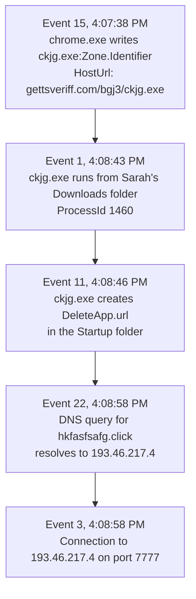

# Windows Logging for SOC - SOC Investigation Lab

**Platform:** TryHackMe | **Difficulty:** <!-- fill in -->

> **Status:** Complete. Tasks 1 to 8 documented.

**_Essential Notes on [Windows Logging Essentials: Event ID Reference and Interview Notes](https://github.com/angeline-infosec/notes/blob/main/Windows-logging-essentials-notes.md)_**
---

## Lab Overview

This room is the start of a Windows logging path for SOC analysts. Analysts spend most of their time triaging alerts and hunting through logs in a SIEM, so knowing how Windows logs look, how to read them, and what malicious activity they point to is a core skill.

The room's learning objectives were to find and interpret important Windows event logs, understand monitoring sources like Sysmon and PowerShell, and practice log analysis on several datasets. I worked as an analyst on a Windows host (THM-PC) using Event Viewer and investigated three data sources:

- **`Practice-Security.evtx`**: a Security log containing a brute force attack, a successful RDP login, and a backdoor account (Tasks 3 and 4).
- **`Practice-Sysmon.evtx`**: a Sysmon log containing a user who downloaded and ran malware (Tasks 5 and 6).
- **PowerShell history files**: command history for the local users (Task 7).

---

## Lab Setup (Task 1)

The lab machine is a Windows host reached over RDP. I connected from my Linux VM using Remmina.

**Scan first:**

```bash
nmap -sCV 10.48.135.239 -Pn
```

The scan showed 999 filtered ports and one open port: `3389/tcp` (ms-wbt-server, Microsoft Terminal Services). The RDP certificate and NTLM info both named the host `THM-PC`.


**Connecting with Remmina:**

```bash
sudo apt install remmina remmina-plugin-rdp
remmina
```

In Remmina I set the protocol to RDP, entered the machine IP, and logged in as `Administrator` with the password given in the room. I accepted the certificate warning when it appeared.


**Note on IPs:** The lab machine expired a couple of times while I worked, so IPs differ between screenshots. This write-up uses `10.48.135.239`.

### Connection troubleshooting

My first machine never answered on port 3389 and nmap reported the port as `filtered`. A fresh machine worked, and the port showed as `open`. Things I learned from this:

- RDP is not a web service, so opening `IP:3389` in a browser does nothing useful.
- A failed ping is not proof the machine is down. Windows hosts can drop ICMP.
- With `-Pn`, nmap skips host discovery, so "Host is up" tells you nothing. The port state is what counts.
- I was also running a VPN on my laptop underneath the TryHackMe VPN in my VM. TryHackMe's troubleshooting guide says to close other VPN services before using OpenVPN. <!-- add whether turning the laptop VPN off fixed it, or whether the fresh machine alone fixed it -->

---

## Task 2: What Is Logged

### Why logging matters for a SOC

Whenever something happens on a system (a login, a program starting, a file being created), the OS can record it as a log entry with the time, the action, and the user behind it. Good logging supports three core SOC activities:

- **Alerting and triage:** Logs are the building block of every alert and detection rule. Triage means checking whether an alert is real by looking at the logs behind it.
- **Threat hunting:** Logs let you search for signs of malicious activity that no alert caught.
- **Incident response:** Logs show when and how an attack happened, so you can build a timeline.

### Where Windows stores logs

Windows logs are stored in a binary format as `.evtx` files in `C:\Windows\System32\winevt\Logs`. Opening one in Notepad shows unreadable output, which is why a parsing tool is needed.


Each `.evtx` file is one log category. For example:

- **Application** logs hold events from user-mode applications such as IIS or MS SQL.
- **Security** logs hold events such as logon attempts, process activity, and user management.

### Reading logs with Event Viewer

Event Viewer is the built-in tool. Open it by searching for "Event Viewer" or pressing `Win + R`, typing `eventvwr`, and pressing Enter.


1. **Log sources:** each `.evtx` file is one item in the left panel.
2. **Log list:** each row is one event. Useful columns are Keywords (success or failure), Date and Time, and Event ID.
3. **Log details:** the content of the event in plain text or XML (the Details tab).
4. **Filters:** "Filter Current Log" and "Find" in the Actions panel.

Two things worth remembering:

- Timestamps in Event Viewer are **system time, not UTC**. This matters when correlating with other log sources.
- An Event ID is a fixed number for an event type. A failed login is always 4625.

The room notes there are over 500 Security event IDs, and not every event is logged by default.

### Question

**Looking at the last screenshot, which event ID describes a successful login?**

The screenshot shows the Security log with an event whose task category is Logon and whose description reads "An account was successfully logged on."

**Answer:** `Security / 4624`

---

## Task 3: Security Log: Authentication <!-- confirm task title -->

### Reading a 4624 event

A 4624 event has several account sections, and picking the wrong one is an easy mistake. The room's annotated example makes these points:

- The first **Subject** section is misleading. In the example it shows `SYSTEM` and the machine account (`THM-PC$`). Ignore it.
- **Logon Type** tells you the login method. `10` is RDP and `3` is network.
- The **New Logon** section holds the account that actually logged in, plus the **Logon ID** to note down.
- **Source Network Address** can be trusted. The workstation name cannot, per the room.


### Investigation

I opened `Practice-Security.evtx` from the Desktop. The saved log contained 84 events.

#### Which IP performed a brute force of THM-PC?

I used **Filter Current Log**, entered Event ID `4625` (failed logon), and entered `THM-PC` in the Computer field. In an event where an unknown source tried to log in as `Administrator`, the XML View of the Details tab showed the source IP in the `IpAddress` field.


**Answer:** `10.10.53.248`

#### Which user was breached as a result of the attack?

The question implies the attacker got in, so I switched to successful logons (Event ID `4624`) and used **Find** with the attacker IP `10.10.53.248`. It returned a successful login for `Administrator`. This fits the pattern: failed attempts against the Administrator account, then a success from the same source.

**Answer:** `Administrator`

#### What was the Logon ID of the malicious RDP login?

The question said to look for Logon Type 10. Using **Find** with the attacker IP, I located the 4624 event with `LogonType 10` and read the **TargetLogonId** in the Details tab. I used the `TargetLogonId` and not the Subject's Logon ID, because the Subject section describes the machine, not the logged-in user. The event was logged around 10:56 PM on 5/17/2025 (system time).


**Answer:** `0x183C36D`

### MITRE ATT&CK Mapping

<!-- verify technique IDs on attack.mitre.org before publishing -->

| Tactic | Technique |
|--------|-----------|
| Credential Access | T1110 - Brute Force |
| Lateral Movement | T1021.001 - Remote Services: Remote Desktop Protocol |
| Initial Access / Persistence | T1078 - Valid Accounts |

---

## Task 4: Security Log: User Management

### Why user management events matter

A common IT conversation goes: "Is `svc_sysrestore` your account? I've never seen it." "No, but it's probably some Windows thing, better not touch it." That kind of assumption is how backdoor accounts survive. User management events let an analyst reconstruct the full history of any account.

| Event ID | What happened | How attackers abuse it |
|----------|---------------|------------------------|
| 4720 / 4722 / 4738 | Account created / enabled / changed | Create a backdoor account, or enable an old one to avoid attention |
| 4725 / 4726 | Account disabled / deleted | Disable privileged SOC accounts to slow defenders down |
| 4723 / 4724 | Password changed by user / reset by someone else | Reset a password, then log in as that user |
| 4732 / 4733 | Member added to / removed from a security group | Add a backdoor account to a privileged group |

### Structure of a user management event

All of these events share the same three parts:

1. **Subject:** who performed the action. The **Logon ID** here lets you link the event back to the 4624 login that started the session.
2. **Object:** the target of the action. It may be labeled New Account, Member, or Target Account depending on the event ID.
3. **Details:** the changes made, such as the target group for 4732 or account attributes for 4720.

> The example screenshots below come from the room's explanation (an account called `itsupport`), not from my investigation.


### Hunting for backdoored users

The room's workflow:

1. Filter the Security log for `4720` and `4732`.
2. Review each event for red flags: nobody in IT can confirm the action, it happened outside working hours or on a weekend, the subject account is unknown or unexpected, or the target name breaks the normal naming pattern.
3. If the action looks malicious, copy the **Logon ID** from the event and find the 4624 login with the same Logon ID.

### Investigation

I continued with `Practice-Security.evtx`.

#### Which user was created by the attacker soon after the RDP login?

I filtered for Event ID `4720` (account created) and opened the Details tab in XML View. The subject was `Administrator` (the account performing the action) and the `TargetUserName` was `svc_sysrestore`.


**Answer:** `svc_sysrestore`

#### Which two privileged groups was the backdoor user added to?

I filtered for Event ID `4732` (member added to a security group). One event showed the group `Remote Desktop Users` and another event with the same ID showed `Backup Operators`. <!-- confirm the Member in both events is svc_sysrestore -->

**Answer:** `Backup Operators, Remote Desktop Users`

#### Does the Logon ID field match what you saw in the previous task?

**Answer:** `Yea`

This is the most important finding of the Security log work. The Logon ID in the account creation event matched the Logon ID of the attacker's RDP session (`0x183C36D`), which shows the backdoor account was created inside the attacker's session and not by a legitimate administrator.

### MITRE ATT&CK Mapping

<!-- verify technique IDs on attack.mitre.org before publishing -->

| Tactic | Technique |
|--------|-----------|
| Persistence | T1136.001 - Create Account: Local Account |
| Persistence / Privilege Escalation | T1098 - Account Manipulation |

---

## Task 5: Sysmon: Process Monitoring

### Why process monitoring matters

The room opens with a short conversation. A SOC analyst asks Sarah whether she ran any files from the Internet recently. She says never. Then the analyst tells her that her IP is trying to brute-force production servers. Authentication logs alone would show the brute force, but not **how** her machine got compromised. Process monitoring answers that, because almost every attack needs some process to launch on the endpoint.

Windows has two ways to log process creation:

| Event | Source | What it does | Limitation |
|-------|--------|--------------|------------|
| 4688 | Security log (Process Creation) | Logs every new process with its command line and parent process | Disabled by default, must be enabled by policy |
| 1 | Sysmon (Process Creation) | Replaces 4688 and adds fields like the file hash | Sysmon is an external tool and is not installed by default |

**What is Sysmon?** System Monitor is a free Microsoft Sysinternals tool. It runs as a Windows service and a device driver and writes detailed events about system activity to its own log. The room recommends Sysmon over the basic, noisy 4688 event. In Event Viewer the log is found under:

`Applications and Services Logs > Microsoft > Windows > Sysmon > Operational`

Sysmon also lets you configure what to log and what to skip. The room uses a popular community config by Florian Roth.

### How to read a Sysmon Event ID 1 (field guide)

This was the part I found hardest, so here is a field-by-field breakdown using a real event from the room. It is a Process Create event for the Windows Settings app launched by the Administrator:

```text
Process Create:
RuleName: -
UtcTime: 2025-05-19 12:08:26.600
ProcessGuid: {c5d2b969-1f3a-682b-2702-000000001801}
ProcessId: 1824
Image: C:\Windows\ImmersiveControlPanel\SystemSettings.exe
FileVersion: 10.0.17763.7309 (WinBuild.160101.0800)
Description: Settings
Product: Microsoft® Windows® Operating System
Company: Microsoft Corporation
OriginalFileName: SystemSettings.exe
CommandLine: "C:\Windows\ImmersiveControlPanel\SystemSettings.exe" -ServerName:microsoft.windows.immersivecontrolpanel
CurrentDirectory: C:\Windows\ImmersiveControlPanel\
User: THM-PC\Administrator
LogonGuid: {c5d2b969-0924-682a-e2c3-050000000000}
LogonId: 0x5C3E2
TerminalSessionId: 2
IntegrityLevel: High
Hashes: MD5=AC5013C7...,SHA256=6F83B102...,IMPHASH=EC87C68A...
```

The fields fall into the four groups the room describes:

#### Process Info: what was launched

| Field | In this event | What it means | Why an analyst cares |
|-------|---------------|---------------|----------------------|
| **RuleName** | `-` | A label set by the Sysmon config rule that matched. `-` means no label. | Some configs tag events with an ATT&CK ID (the Task 6 file event shows `T1023`). |
| **UtcTime** | 2025-05-19 12:08:26.600 | When the process started, in UTC | Gives a clean timeline with no time zone guessing. |
| **ProcessGuid** | `{c5d2b969-1f3a-...}` | A unique ID for this one run of the process | Microsoft's docs describe it as a unique value for the process across a domain, to make event correlation easier. |
| **ProcessId** | 1824 | The process ID (PID) in decimal | The number you search for to find the other events (network, file, DNS) from the same process. Windows can reuse PIDs later, so the GUID is the safer match. |
| **Image** | `C:\Windows\ImmersiveControlPanel\SystemSettings.exe` | The full path of the program | Location says a lot. A Windows folder is normal. `Downloads`, `Temp`, or `Public` are not. |
| **CommandLine** | the path plus `-ServerName:...` | The exact command used to launch it, including arguments | Attackers hide behavior in arguments (URLs, encoded commands). |
| **CurrentDirectory** | `C:\Windows\ImmersiveControlPanel\` | The folder the process started in | A process starting in `Downloads` hints at where it came from. |

#### Binary Info: what the file is

| Field | In this event | What it means | Why an analyst cares |
|-------|---------------|---------------|----------------------|
| **FileVersion, Description, Product, Company** | 10.0.17763.7309, Settings, Microsoft Windows, Microsoft Corporation | Descriptive details stored inside the file by whoever built it | Quick sanity check. It is a clue and not proof, because the builder chooses these values. |
| **OriginalFileName** | `SystemSettings.exe` | The file name recorded inside the binary at build time | If it differs from the name in `Image`, the file was probably renamed. |
| **Hashes** | MD5, SHA256, IMPHASH | Fingerprints of the file. IMPHASH is a hash of the functions the file imports. | Search the hash on VirusTotal to see if it is known malware. |

#### User Context: who ran it

| Field | In this event | What it means | Why an analyst cares |
|-------|---------------|---------------|----------------------|
| **User** | `THM-PC\Administrator` | The account the process ran as | Is this user expected to run this program? |
| **LogonId** | `0x5C3E2` | The ID of the login session. It is the **same Logon ID as in the Security log**. | This is the bridge between Sysmon and Security logs (see the correlation section below). |
| **LogonGuid** | `{c5d2b969-0924-...}` | A GUID form of the logon session | Same idea as LogonId. |
| **TerminalSessionId** | 2 | The Windows session the process runs in | Separates interactive sessions (console, RDP) from background services. |
| **IntegrityLevel** | `High` | The privilege level of the process (Low, Medium, High, System) | `High` means elevated, as an admin. In Sarah's logs her Chrome ran at `Medium`. |

#### Parent Info: what launched it

The event I pasted from the room was cut off before the parent fields. A full Event ID 1 also contains `ParentProcessGuid`, `ParentProcessId`, `ParentImage`, `ParentCommandLine` and `ParentUser`. These are the fields that let you build a **process tree**: who started this process, and who started that one. A process with an unexpected parent (for example Notepad launching `cmd.exe`) is a red flag.

#### Reading this example like an analyst

- The path is in a Windows folder, the metadata is Microsoft's, and `OriginalFileName` matches `Image`.
- It ran as the Administrator at High integrity, which fits a user opening the Settings app.
- This looks benign, but I could not call it clean without the parent fields and a hash check.

Now compare it with the suspicious process from Sarah's log, explained in the investigation below: `C:\Users\sarah.miller\Downloads\ckjg.exe`, a random-looking name, an executable running from the Downloads folder, descriptive fields reading `CxApp`, and an `OriginalFileName` of `Stub.exe` that does not match the file name.

### The same event in two logs

The room shows one `cmd.exe` launch recorded by both Security 4688 and Sysmon 1. Putting them side by side shows how the logs line up:

| What | Security 4688 | Sysmon 1 |
|------|---------------|----------|
| Program | New Process Name: `C:\Windows\System32\cmd.exe` | Image: `C:\Windows\System32\cmd.exe` |
| Process ID | New Process ID: `0x19d4` (hex) | ProcessId: `6612` (decimal) |
| Parent | Creator Process Name: `explorer.exe`, ID `0x420` (hex) | ParentImage: `explorer.exe`, ParentProcessId: `1056` (decimal) |
| Command line | Process Command Line | CommandLine |
| User and session | Creator Subject: `Administrator`, Logon ID `0x2C7896` | User: `THM-PC\Administrator`, LogonId: `0x2C7896` |
| Privilege | Mandatory Label: High | IntegrityLevel: High |
| File hash | not included | Hashes: MD5 and SHA256 |

Two things stand out. The process IDs are the **same numbers in different formats** (`0x19d4` is 6612 and `0x420` is 1056), so convert before comparing. And the **Logon ID is identical**, which is what ties the two logs to the same session.


### Workbook: analyze a process launch

1. Open the Sysmon log and filter for Event ID `1`.
2. Check the process and binary fields. Red flags: the image is in an uncommon folder such as `C:\Temp` or `C:\Users\Public`, the name looks random (like `aa.exe` or `jqyvpqldou.exe`), or the hash is flagged as malware on VirusTotal.
3. Check the parent fields. Red flags: the parent itself matches step 2, or the parent is unexpected.
4. If still unsure, walk up the tree: find the earlier event whose `ProcessId` equals your event's `ParentProcessId`, and repeat steps 2 and 3.
5. Finally, filter Security and Sysmon events by the same Logon ID to trace the attack chain.

### Investigation

I opened `Practice-Sysmon.evtx` from the Desktop (29 events in total).

#### Which web browser does Sarah use to browse the web?

I filtered for Event ID `1` and looked through the earliest process creation entries, as the hint suggested. The filter returned 7 process creation events. <!-- your notes mention five events after a date filter, but the screenshot header shows 7, reconcile --> One event had `OriginalFileName: chrome.exe`, the user `THM-PC\sarah.miller`, and `explorer.exe` as its parent, which is what you would expect from a user opening a browser from the desktop.


**Answer:** `Google Chrome`

#### Which file did Sarah download from the browser?

Another Event ID 1 showed a process running from Sarah's Downloads folder. The image path was `C:\Users\sarah.miller\Downloads\ckjg.exe`, the descriptive fields read `CxApp`, and `OriginalFileName` was `Stub.exe`, which does not match the file name. The event is time-stamped 4:08:43 PM.


**Answer:** `C:\Users\sarah.miller\Downloads\ckjg.exe`

#### Which URL was the file downloaded from?

Event ID 1 does not hold the download URL, and the question hinted at using other Sysmon events. The hint pointed to a SANS article on Sysmon and alternate data streams. The idea: when a browser saves a file, Windows attaches a hidden extra stream to it called `Zone.Identifier`, which records where the file came from. Sysmon logs this as **Event ID 15 (FileCreateStreamHash)**.

The event, logged at 4:07:38 PM, shows `chrome.exe` creating `ckjg.exe:Zone.Identifier` in Sarah's Downloads folder. Its contents include a `ZoneId` and the `HostUrl` the file came from. <!-- verify ZoneId=3 means the Internet zone before publishing -->


**Answer:** `http://gettsveriff.com/bgj3/ckjg.exe`

The download (4:07:38 PM) and the launch (4:08:43 PM) are about a minute apart.

### MITRE ATT&CK Mapping

<!-- verify technique IDs on attack.mitre.org before publishing -->

| Tactic | Technique |
|--------|-----------|
| Execution | T1204.002 - User Execution: Malicious File |

---

## Task 6: Sysmon: Files and Network

### More Sysmon events

Process creation shows that something ran. Other Sysmon events show **what it did**. The room covers four more:

| Event ID | Name | What it records | Why it matters |
|----------|------|-----------------|----------------|
| 11 | File Create | A file was created, and by which process | Detects files dropped by malware |
| 13 | Registry Value Set | A registry value was written | Detects configuration changes such as persistence |
| 3 | Network Connection | A process connected to an IP and port | Detects traffic from untrusted processes |
| 22 | DNS Query | A process asked for a domain name, and what came back | Detects lookups of suspicious domains |

The security log equivalents are mostly disabled by default (4656 for file changes and 4657 for registry changes), and there is no direct equivalent for network and DNS without extra firewall and DNS configuration.

During the lab I also met two more events: **Event ID 15** (FileCreateStreamHash, used in Task 5) and **Event ID 10** (ProcessAccess), which appears in the log right after the C2 connection.

### The structure of these events

These events share the same layout (highlighted in orange in the room's screenshot): a **Process Info** block (`ProcessId`, `Image`) and a **User Info** block, followed by event-specific details.


Notice what is **missing**: no Logon ID and no parent process fields. That is by design. You take the `ProcessId` from the event and use it to find the matching Event ID 1, which holds the full context (parent, Logon ID, hash).

### Red flags

- **Network:** connections to external IPs on port 80 or on unusual ports like 4444, connections to IPs known as malicious, and DNS queries for suspicious domains (the room mentions `.top` and `.click`).
- **Files and registry:** files dropped in staging folders like `C:\Temp` or `C:\Users\Public`, dropped scripts (`.bat`, `.ps1`) or executables (`.exe`, `.com`), and created files or registry keys that give persistence.

### How the events connect: the correlation chain

This is how Sysmon correlation works. Three identifiers do the linking:

| Identifier | Where it appears | What it links |
|------------|------------------|---------------|
| **ProcessId / ProcessGuid** | Every process-related Sysmon event (1, 3, 11, 13, 15, 22) | All the actions of **one process** |
| **ParentProcessId / ParentProcessGuid** | Event ID 1 only | A process to **the process that launched it** (the process tree) |
| **LogonId** | Event ID 1 and Security log events | A process to **the login session** that started it, and to Security events from the same session |

**Step by step, using Sarah's log:**

1. Start with the suspicious Event ID 1: `ckjg.exe`, **ProcessId 1460**.
2. Search the Sysmon log for other events with **ProcessId 1460**. Each one is an action performed by this one process. The `ProcessGuid` (`{c5d2b969-060b-682a-490c-000000001701}` in the events I opened) is the same in all of them.
3. Read each event to build the story:
   - **Event 11** shows `ckjg.exe` creating a file in the Startup folder.
   - **Event 22** shows `ckjg.exe` looking up a domain.
   - **Event 3** shows a connection from the host to an external IP and port.
4. Go back to the Event ID 1 and read its **parent fields** to see who launched it, then repeat the steps for the parent.
5. Take the **LogonId** from Event ID 1 and search the Security log for the same value to see the login behind it.

**The chain of events in Sarah's log:**



> The two practice files are separate scenarios. `Practice-Security.evtx` covers the Administrator attack from Tasks 3 and 4, and `Practice-Sysmon.evtx` covers Sarah's workstation. The Logon ID pivot is shown working inside the Security log in Task 4. For Sarah, the Event ID 1 contains her `LogonId`, which is the value you would search for in a Security log from her session. <!-- confirm Sarah's LogonId from the chrome event screenshot (looks like 0x1F98906) -->

### Investigation

I continued with `Practice-Sysmon.evtx`.

#### Which file was created by the downloaded malware to persist on the host?

The hint said to look at the malware's first action after being launched. I looked for Event ID 11 (File Create) events with `ProcessId 1460` (the `ckjg.exe` process). One event at 4:08:46 PM showed `ckjg.exe` creating a file in the Startup folder. Files in a user's Startup folder are processed when the user logs in, which makes it a persistence location.


**Answer:** `C:\Users\sarah.miller\AppData\Roaming\Microsoft\Windows\Start Menu\Programs\Startup\DeleteApp.url`

#### What is the Command & Control server the malware connected to?

The hint said to look at all network connections made by the malware. I found the Event ID 3 (Network Connection) at 4:08:58 PM. The source was the host `THM-PC` (`10.10.57.125`, port 50558) and the destination was an external IP on a non-standard port.


**Answer:** `193.46.217.4:7777`

#### Which domain does the malicious IP correspond to?

The hint said to review the `QueryResults` and `QueryStatus` fields. I looked at Event ID 22 (DNS Query) events from the `ckjg.exe` process. The one at 4:08:58 PM had `QueryStatus: 0`, meaning the lookup succeeded, and its `QueryResults` contained `193.46.217.4`, the C2 IP. The queried name used a `.click` domain, one of the suspicious top-level domains the room lists.


**Answer:** `hkfasfsafg.click`

### MITRE ATT&CK Mapping

<!-- verify technique IDs on attack.mitre.org before publishing -->

| Tactic | Technique |
|--------|-----------|
| Persistence | T1547.001 - Boot or Logon Autostart Execution: Registry Run Keys / Startup Folder |
| Command and Control | T1571 - Non-Standard Port |

---

## Task 7: PowerShell: Logging Commands

### Why Sysmon is not enough here

Attackers love PowerShell because it is built in, trusted, and powerful: it can download malware, run system discovery, exfiltrate data, and more. The problem for defenders is that Sysmon Event ID 1 only logs that `powershell.exe` started. A single PowerShell window can then run hundreds of commands without creating another process, so process logs show one event and no commands.

### The PowerShell history file

The room uses a simple method: the PowerShell history file.

```text
C:\Users\<USER>\AppData\Roaming\Microsoft\Windows\PowerShell\PSReadline\ConsoleHost_history.txt
```


Key notes from the room:

- It records every command typed into a PowerShell window, updated when you press Enter.
- It is created **per user**, so five active users means up to five files.
- It survives reboots unless someone deletes it.
- It does **not** log command output, and it does not show the content of scripts (for example when running `powershell .\script.ps1`).

### Investigation

I reviewed the Administrator's history on the VM.

#### Which PowerShell command was executed first?

I opened the history file at the path above. The first line of the file is the first command executed.


**Answer:** `Get-ComputerInfo`

#### When did the Administrator run the first PS command?

I right-clicked the history file and opened **Properties**. The **Created** date is when the file was first made, which is when the first command was saved: Sunday, May 18, 2025, 8:49:26 PM. The Modified and Accessed dates (June 21, 2026) show later activity.


**Answer:** `May 18, 2025`

#### Can you find the flag stored in the PowerShell history?

The hint said to check the history of other local users. The `Users` folder had three accounts: `Administrator`, `thm.alex`, and `thm.bob`. I checked the same path for each. The flag was in `thm.bob`'s history:

```text
cd .\Documents\
ls
get-localuser > users.txt
get-smbshare > shares.txt
ipconfig /all > network.txt
echo "THM{it_was_me!}" > flag.txt
get-mppreference > defender.txt
clear-recyclebin
```


**Answer:** `THM{it_was_me!}`

### What thm.bob's history shows

Even without seeing output, the commands tell a story that matches a typical post-compromise routine:

- `get-localuser` lists the local accounts.
- `get-smbshare` lists network shares.
- `ipconfig /all` collects network configuration.
- `get-mppreference` reads Microsoft Defender settings.
- Results are saved to text files, and `clear-recyclebin` removes traces.

On its own I would treat this as suspicious and escalate it for review, since system discovery followed by cleanup is a pattern worth confirming with the user.

### MITRE ATT&CK Mapping

<!-- verify technique IDs on attack.mitre.org before publishing -->

| Tactic | Technique |
|--------|-----------|
| Execution | T1059.001 - Command and Scripting Interpreter: PowerShell |
| Discovery | T1087.001 - Account Discovery: Local Account |
| Discovery | T1135 - Network Share Discovery |
| Discovery | T1016 - System Network Configuration Discovery |
| Discovery | T1518.001 - Software Discovery: Security Software Discovery |
| Defense Evasion | T1070.004 - Indicator Removal: File Deletion |

---

## Task 8: Conclusion

The room's key takeaways:

- Know how to read 4624 and 4625 events. They come up constantly in SOC work.
- Group logs by **Logon ID** and **Process ID** to see the attack chain quickly.
- Learn Sysmon and use it. It gives the most context about what happened.
- Do not forget PowerShell logging. Its use in attacks keeps growing.

### Action points: how to practice them

The room ended with three suggestions for further practice. Here is how I plan to do each one.

#### 1. Event Viewer XML filtering

The normal filter dialog handles one condition at a time. For multiple conditions, use **Filter Current Log > XML tab > Edit query manually**. Windows Event Log queries use a subset of XPath 1.0 wrapped in a `QueryList`, per Microsoft's documentation, and the conditions can be joined with `and` and `or`.

Example to find RDP logins (4624 with Logon Type 10):

```xml
<QueryList>
  <Query Id="0">
    <Select Path="Security">
      *[System[(EventID=4624)]]
      and *[EventData[Data[@Name='LogonType']='10']]
    </Select>
  </Query>
</QueryList>
```

Example to find every Sysmon event from one process in the saved log:

```xml
<QueryList>
  <Query Id="0">
    <Select Path="file://C:\Users\Administrator\Desktop\Practice-Sysmon.evtx">
      *[EventData[Data[@Name='ProcessId']='1460']]
    </Select>
  </Query>
</QueryList>
```

<!-- these two queries are patterns I have not run in the lab yet, test them before keeping them in the write-up -->

#### 2. Logon ID correlation workflow

A repeatable routine:

1. Filter for 4625 and 4624 to find the failed and successful logins.
2. Copy the **Logon ID** of the suspicious login.
3. Use **Find** (or an XML filter) to search for that Logon ID in the Security log and the Sysmon log.
4. Sort the results by time to get the timeline of that session.
5. For any suspicious process, pivot on its **ProcessId** to see its file, registry, DNS and network activity.

#### 3. PowerShell logging beyond the history file

The history file misses commands run from scripts and does not record output. The next step is **Script Block Logging**, which Microsoft's documentation says logs the content of script blocks as **Event ID 4104** in the `Microsoft-Windows-PowerShell/Operational` log. It is turned on by Group Policy or a registry setting. <!-- the room's own wording for this action point mixed up Event 4104 with transcription and event forwarding, and mentioned AMSI Event ID 8002, which I could not verify, so I kept only what Microsoft documents -->

To practice: enable it on a **test VM** (never a production machine), run a few PowerShell commands, then open `Applications and Services Logs > Microsoft > Windows > PowerShell > Operational` and filter for Event ID 4104. AMSI and PowerShell transcription are separate topics I still need to read about.

---

## Reconstructed Attack Timelines

### Timeline 1: Administrator account (Security log)

1. **Brute force:** repeated failed logons (4625) against `Administrator` from `10.10.53.248`.
2. **Successful RDP login:** a 4624 event with Logon Type 10 from the same IP, Logon ID `0x183C36D`, around 10:56 PM on 5/17/2025.
3. **Persistence:** the `Administrator` session created a new local account, `svc_sysrestore` (4720).
4. **Privilege and access:** the new account was added to `Backup Operators` and `Remote Desktop Users` (4732).

### Timeline 2: Sarah's workstation (Sysmon log, 5/18/2025)

1. **Download:** `chrome.exe` saved `ckjg.exe` from `http://gettsveriff.com/bgj3/ckjg.exe` (4:07:38 PM).
2. **Execution:** `ckjg.exe` ran from Sarah's Downloads folder (4:08:43 PM).
3. **Persistence:** it created `DeleteApp.url` in the Startup folder (4:08:46 PM).
4. **Command and control:** it resolved `hkfasfsafg.click` to `193.46.217.4` and connected to it on port `7777` (4:08:58 PM).

---

## Why This Matters

Each event on its own is easy to dismiss. A failed login happens all the time, a new service-style account looks routine, and a user downloading a file is normal. The attacks only become obvious when events are connected: the same source IP across failed and successful logons, the same Logon ID across a login and the actions that followed, and the same Process ID across a file drop, a DNS query and an outbound connection. The account name `svc_sysrestore` is also a good example of blending in. It looks like a Windows service account, which is exactly why an analyst might leave it alone.

## How I'd Improve Detection

- Alert on a burst of 4625 events from one source IP followed by a 4624 from the same IP.
- Alert on RDP logons (Logon Type 10) from unexpected or external sources.
- Alert on a 4720 followed by a 4732 within a short window, especially into privileged groups.
- Require a ticket or approval for new accounts, so an unexplained 4720 is automatically suspicious.
- Install Sysmon with a maintained config so process, file, registry, DNS and network events are all logged.
- Alert on executables launched from user Downloads, Temp or Public folders.
- Alert on a process that creates files in a Startup folder and then makes an outbound connection.
- Enable PowerShell Script Block Logging and collect the PowerShell history files during investigations.
- Reduce exposure: restrict RDP access, enforce account lockout, and use MFA where possible.

---

## Key Takeaways

- **Pick the right section of the event.** In a 4624, the real user and Logon ID are in New Logon, not Subject.
- **The Logon ID ties sessions together.** It links a login to every action taken in that session, across Security and Sysmon logs.
- **The ProcessId ties a process together.** Sysmon file, registry, DNS and network events all point back to their Event ID 1 through it.
- **Source IP beats hostname.** The IP is the more reliable field, though it can still be a proxy or VPN.
- **Single events mislead.** The story comes from correlating events.
- **Never assume an unfamiliar account or file is harmless.** Verify who created it, when, and from which session.
- **Process logs do not show PowerShell commands.** The history file and script block logging fill that gap.

## Skills Practiced

- Windows Event Log analysis with Event Viewer
- Filtering by Event ID and searching by IP, Logon ID and ProcessId
- Authentication and user management event analysis (4624, 4625, 4720, 4732)
- Sysmon analysis (Event IDs 1, 3, 11, 13, 15, 22)
- Process tree and attack chain reconstruction
- PowerShell history analysis
- MITRE ATT&CK technique mapping

## Tools & Technologies

- Windows Event Viewer
- Sysmon (Sysinternals)
- `.evtx` log files (`Practice-Security.evtx`, `Practice-Sysmon.evtx`)
- PowerShell history files (`ConsoleHost_history.txt`)
- Nmap
- Remmina (RDP client)

---

## Loose Ends

- I found the attacker IP in Task 3 from a single 4625 event. The stronger evidence of a brute force is the number of failed attempts from that IP in a short time. <!-- add the count of 4625 events from 10.10.53.248 and the time window -->
- The 4625 event showed a status code of `0xc000006d`. I did not look up its meaning, so I am not stating one here.
- In the Sysmon log I did not open the **Event ID 13** (registry value set) events at 4:08:06 PM and 4:08:43 PM, or the **Event ID 10** (ProcessAccess) and extra **Event ID 1** events right after the C2 connection at 4:08:58 PM. The room's questions did not ask about them, but they could show more persistence or follow-on activity. <!-- open them and add what you find -->
- I did not look up the `ckjg.exe` hash on VirusTotal, which the room's workbook recommends.
- The Administrator's PowerShell history included commands that disable the Remote Desktop service and save the SYSTEM registry hive. The room did not ask about these, and I could not tell from the history alone whether they were maintenance or malicious. <!-- decide whether to keep this note -->

## Q&A

**Q: What is the difference between Event ID 4624 and 4625?**

A: 4624 means an account was successfully logged on, and 4625 means a logon attempt failed. Together they are the basis for spotting brute force: many 4625 events followed by a 4624 from the same source.

**Q: A 4624 event has more than one account section. Which one do you read?**

A: The New Logon section. The Subject section can show `SYSTEM` or the machine account (like `THM-PC$`), which is misleading. The user who actually logged in, and the Logon ID, are in New Logon.

**Q: What does Logon Type 10 mean, and why would you care?**

A: Type 10 is an RDP (remote interactive) login. Type 3 is a network login. RDP logons deserve attention because they give an attacker an interactive session, so an unexpected Type 10 from an unfamiliar IP is worth investigating.

**Q: How would you spot a brute force attack in Event Viewer?**

A: Filter for Event ID 4625 and look for many failures from the same source IP in a short time, often against the same account. Then check for a 4624 from that IP, because a success after many failures suggests the attack worked.

**Q: Which is more reliable in a logon event, the source IP or the workstation name?**

A: The source IP. The room points out the hostname is not reliable. The IP can still be a VPN, proxy, or NAT address, so it needs context, but it reflects where the connection came from.

**Q: How do you connect a login to what the attacker did afterward?**

A: Use the Logon ID. The 4624 event records it for the new session, and user management events (4720, 4732) record it in their Subject section. Matching Logon IDs shows the actions happened inside that session. In my lab, the Logon ID of the account creation matched the RDP login.

**Q: Which events would you check if you suspect a backdoor account?**

A: 4720 for account creation, and 4732 for additions to security groups. Also 4722 (enabled), 4738 (changed), and 4724 (password reset) for accounts that were modified instead of created.

**Q: What red flags make a 4720 event suspicious?**

A: No one in IT can confirm it, it happened outside working hours or on a weekend, the subject account is unexpected, or the new account name does not follow the usual naming pattern.

**Q: A colleague says an unfamiliar account called `svc_sysrestore` is probably a Windows thing and should be left alone. What do you do?**

A: I would not assume. I would check who created it and when (4720), which groups it joined (4732), and whether the Logon ID ties it to a suspicious login. If nobody can confirm it and it traces back to an unusual session, I would escalate it as a possible backdoor.

**Q: What is Sysmon, and why use it instead of the Security log's 4688 event?**

A: Sysmon is a free Microsoft Sysinternals tool that runs as a service and driver and logs detailed system activity. Its Event ID 1 covers the same process creation as 4688 but adds file hashes and more, and 4688 is disabled by default and needs a policy change. Sysmon also logs file, registry, DNS and network events that the default logs do not.

**Q: In a Sysmon Event ID 1, which fields do you look at first?**

A: The Image path and CommandLine to see what ran and how, then the parent fields to see what launched it, then the hash and OriginalFileName to check what the file is, and finally User and LogonId to see who ran it and in which session.

**Q: How do you follow one process across Sysmon events?**

A: Take the ProcessId (or ProcessGuid) from its Event ID 1 and search for it. The file, registry, DNS and network events from that process carry the same value. Event ID 1 holds the parent process and Logon ID, which the other events do not.

**Q: How do you build a process tree?**

A: Start at the suspicious Event ID 1 and read its ParentProcessId. Find the earlier Event ID 1 whose ProcessId matches it, check that parent for red flags, and repeat until the chain ends at something clearly legitimate. The GUID fields are safer to match than PIDs, since Windows can reuse PIDs.

**Q: How do you link Sysmon logs to Security logs?**

A: The Logon ID. Sysmon Event ID 1 records the LogonId of the user session, and the same value appears in the Security log in the 4624 login and in events like 4688, 4720 and 4732.

**Q: `OriginalFileName` and `Image` do not match on a process. What does that suggest?**

A: The file was probably renamed. In my lab the process `ckjg.exe` had an OriginalFileName of `Stub.exe`. It is not proof of malware on its own, but together with a random name and a Downloads location it is a strong reason to investigate further.

**Q: How would you find where a downloaded file came from?**

A: Look for Sysmon Event ID 15 (FileCreateStreamHash). Browsers attach a `Zone.Identifier` stream to downloaded files, and its contents include the source URL in the HostUrl field.

**Q: What would make you suspect an outbound connection is command and control?**

A: A process that should not be talking to the Internet (like a freshly downloaded executable), a destination on an unusual port such as 7777, a domain on a suspicious top-level domain such as `.click`, and a DNS lookup shortly before the connection. In my lab all of these were true for `ckjg.exe`.

**Q: Why does a PowerShell attack not show up in process creation logs?**

A: Because `powershell.exe` is launched once, and every command typed afterwards runs inside that same process. Process creation logs show one event and no commands.

**Q: Where would you look for the commands an attacker ran in PowerShell?**

A: The user's `ConsoleHost_history.txt` file in the PSReadline folder, which is created per user and survives reboots. Its limits are that it does not record output and does not show the content of scripts, so Script Block Logging (Event ID 4104) is the next step.

**Q: What does the history file's Created date tell you?**

A: It shows roughly when the user first ran a PowerShell command, because the file is created when the first command is saved. In the lab the Administrator's file was created May 18, 2025.

**Q: What would you do after confirming a backdoor account or malware on a machine, as a Tier 1 analyst?**

A: Document the evidence (IPs, account names, hashes, Logon IDs, timestamps) and escalate under the incident response process. Containment steps like disabling accounts, isolating the host or blocking the C2 IP should be done by or agreed with the responsible team, and the scope should be checked by searching for other activity with the same Logon ID or ProcessId.

**Q: Event Viewer shows system time, not UTC. Why does that matter?**

A: When correlating Windows logs with other sources such as firewall or SIEM data, mismatched time zones can make events look out of order or hide a link. Timestamps need to be normalized first. Sysmon helps because it records a UtcTime field.

**Q: What logging or detections would you add after these incidents?**

A: Alerts for bursts of failed logons followed by a success, alerts on unexpected RDP logons, alerts for account creation followed by privileged group changes, Sysmon with a maintained config, alerts on executables run from Downloads or Temp, and PowerShell Script Block Logging.

---

## Conclusion

This room showed how much of an attack can be reconstructed from Windows logs alone. Security logs traced a brute force to a successful RDP login and a backdoor account, Sysmon traced a malicious download to persistence and a command and control connection, and PowerShell history showed what a user did inside a terminal. The main lesson is that individual events are easy to dismiss, but the Logon ID and the ProcessId connect them into a complete story.
